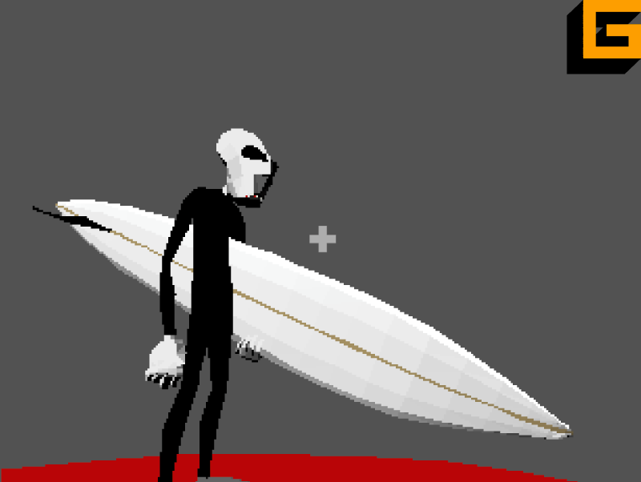

# **Gizmo Engine** _(wasm)_



## About

3D software renderer written in C, compiled to wasm _(via wasi)_ and controlled by Javascript. Its an hobby project for learning purposes only.

## Features

- OBJ model loader _(mesh data only)_
- USD loader for `.usda` files _(meshes, transforms, materials)_
- Z-buffering
- Colored lights: directional, point and spot _(up to 8 per scene)_
- Lighting per triangle, per vertex or per pixel
- Light gizmos _(show/hide with the LIGHTS button)_
- Shadows from every light type _(shadow maps, SHADOWS button)_
- Skeletal animation from USD _(skinning in wasm, named clips, crossfades)_
- Wireframe, shaded and textured render modes

## Check it out

**[https://brunoperry.github.io/gizmo_wasm/web/](https://brunoperry.github.io/gizmo_wasm/web/ "https://brunoperry.github.io/gizmo_wasm/web/")**

## Test it

Clone the repo and run index.html on localhost, no dependencies needed.

## Playing with different models

Open the `/web/resources/data.json` file and add/edit your new object _(name, url, texture)_. Also include/edit your new texture _(name, url)_.

Next, open `web/src/TestScene.js` and add your new model to the scene.

If a file has no normals (or only some), they are computed while loading (any format). Edges sharper than 60° stay hard (a box keeps flat sides), smaller ones are smoothed. An entry can change the angle with `"crease_angle"` (degrees: `0` = faceted, `180` = all smooth):

```json
{ "name": "city_usd", "url": "./resources/meshes/city.usda", "crease_angle": 40 }
```

### USD (`.usda`)

USD files go in `data.json` like OBJ files; `texture` is optional, since it comes from the file's material:

```json
{ "name": "surfer_usd", "url": "./resources/meshes/surfer.usda" }
```

- Each `Mesh` prim becomes an object named after the prim: `Resources.get_object("surfer_usd")`. `Resources.get_objects("<data.json name>")` returns every mesh in the file.
- Transforms (all `xformOp`s, the whole hierarchy) are baked into the vertices, and `upAxis = "Z"` is converted to Y-up. Each object starts at the origin, in the place the file puts it.
- Polygons, holes, `leftHanded` orientation, indexed/non-indexed UVs and normals, and the selected variants are supported.
- The texture comes from the bound `UsdPreviewSurface`: its `UsdUVTexture` file, or a 1x1 texture of its `diffuseColor`. Meshes split into material `GeomSubset`s become one object per material.
- Not supported (a console warning is shown): binary `.usdc`/`.usdz`, references/payloads/sublayers, instancing, animation (the first time sample is used), and non-mesh shapes like `Cube` or `Sphere`.

## Animated models

USD files with a skeleton (UsdSkel: `Skeleton`, `SkelAnimation`, skinned meshes) are animated. The pose and the skinning (dual quaternion or linear, as the file asks) run in wasm; the animation is interpolated between its frames, so it stays smooth at any frame rate.

```json
{
  "name": "inkeeper",
  "url": "./resources/meshes/inkeeper.usda",
  "texture": "inkeeper",
  "clips": { "idle": [0, 120], "wave": [121, 240] }
}
```

`clips` are optional frame ranges (the file's frame numbers, both included). The clip `"default"` always covers the whole animation and starts playing in a loop.

```js
const inkeeper = Resources.get_objects("inkeeper"); // the character's meshes
for (const obj of inkeeper) this.add_obj3d(obj);

const anim = inkeeper[0].animation; // shared by all of them
anim.play("wave", { loop: false, fade: 0.3 }); // crossfades from the current pose
anim.onend = (clip) => anim.play("idle");     // when a non-looping clip ends
anim.speed = 0.5;   // slow motion (negative plays backwards)
anim.time = 2;      // jump to 2 s into the clip
anim.pause(); anim.resume(); anim.stop();
anim.define_clip("intro", 0, 60); // clips can also be defined in code
```

Every `get_objects()` call makes a new character with its own Animator; the skeleton and animation data are shared, so several copies cost little memory. Shadow maps are redrawn while a character moves (about 1 ms per directional/spot light); when it's paused they are cached again.

## Lights

Every scene starts with a white directional light (`scene.light`) and gray ambient light (`scene.ambient`). Add more in your scene's constructor:

```js
import Light3D from "./Light3D.js";

this.add_light(new Light3D({
  type: Light3D.Types.POINT,
  position: vec3(-4, 1, -3),
  color: "#ff8833",
  intensity: 1.4,
  range: 9, // fades to zero at this distance
}));

this.add_light(new Light3D({
  type: Light3D.Types.SPOT,
  position: vec3(4, 7, -2),
  direction: vec3(-0.4, -1, 0.15),
  color: "#4488ff",
  range: 16,
  inner_angle: 12, // full brightness inside, degrees from the axis
  outer_angle: 22, // no light outside, smooth in between
}));

this.ambient = "#141418";
```

Every property (`position`, `color`, `intensity`...) can change at any time. Use `scene.remove_light(light)` to take a light out.

The TRIANGLE / VERTEX / PIXEL buttons choose where lighting is computed:

- **Triangle**: once per triangle (flat, faceted look). Fastest.
- **Vertex**: per vertex, then interpolated (Gouraud). Smooth; small spots of light can fall between vertices.
- **Pixel**: per pixel, from the interpolated position and normal. The most accurate and the most expensive.

Vertex and pixel lighting use the model's vertex normals (from the file, or computed when loading).

### Shadows

The SHADOWS button turns shadows on and off (off by default). Every light casts shadows unless created with `shadows: false` (or `light.shadows = false` later).

- Shadow maps: directional lights use one 512x512 map fitted around the whole scene, spot lights one 512x512 map covering their cone, point lights a 6 x 256x256 cube map.
- They follow the lighting mode: per triangle and per vertex the shadow is sampled at the triangle's centre / at each vertex (coarse), per pixel it is exact with soft (filtered) edges.
- A map is only redrawn when a light or an object moves; moving the camera is free. A static scene costs nothing extra per frame.
- Both sides of every triangle cast shadows, so single-sided walls and planes work. Texture transparency is ignored: transparent pixels still cast shadows.
- Cost when things move (320x240, ~5000 triangles): about 1 ms per directional or spot light, about 2 ms per point light. Use `shadows: false` on lights that don't need them.

## Development

You need the [WASI SDK](https://github.com/WebAssembly/wasi-sdk/releases) (tested with 25.0). Point the makefile at it and build:

```sh
make build WASI_SDK=/path/to/wasi-sdk    # optimized -> web/src/gizmo.wasm
make debug WASI_SDK=/path/to/wasi-sdk    # -O0 with DWARF debug info
```

`WASI_SDK` defaults to `~/libs/wasi-sdk-25.0-x86_64-macos`. The module has no WASI imports (it uses its own bump allocator instead of `malloc`), so it runs in any browser with WebAssembly SIMD support.

### How it renders

- Each object is a triangle soup (9 floats/triangle) written by JS straight into wasm memory.
- Per frame: one model-view matrix per object, back-face culling, frustum clipping only for triangles that cross a plane, then rasterization.
- The rasterizer is a scanline rasterizer with a top-left fill rule. Depth (1/w) and u/w, v/w are stepped per pixel; textures are perspective-corrected every 16 pixels and interpolated in 16.16 fixed point in between.

## Known issues

- No mobile support.

Have fun!
